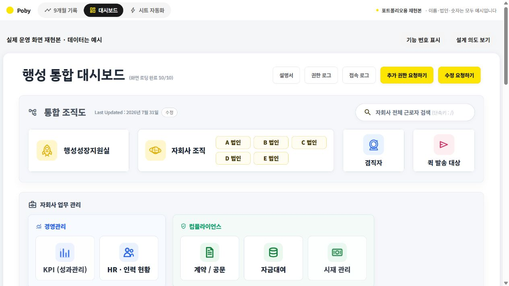

# HR·자회사 관리 업무 자동화

**반복되는 자료 취합과 점검을 개선한 실제 업무 경험입니다.**

카카오모빌리티 행성지원팀에서 맡았던 HR·자회사 관리 업무를 바탕으로, 어떤 문제를 발견했고 어떻게 개선했는지 화면과 사례로 정리했습니다.

**[업무 개선 사례 보기 →](https://poby-ya.github.io/hr-automation-portfolio/)** · [자동화 과정 보기](https://poby-ya.github.io/hr-automation-portfolio/#automation) · [대시보드 보기](https://poby-ya.github.io/hr-automation-portfolio/#dashboard)

> 실제 경험을 포트폴리오용으로 재현했습니다. 화면의 이름·법인·숫자는 예시이며, 표시된 수치를 실제 정량 성과로 제시하지 않습니다.

## 어떤 문제를 다뤘나요?

| 업무에서 겪은 문제 | 개선한 흐름 |
| --- | --- |
| 법인별 인력 자료를 받아 합치고, 숫자가 다르면 원본을 다시 찾아야 했습니다. | 입력 이후 점검·취합·알림을 연결하고, 불일치가 생긴 법인과 월을 확인하도록 구성했습니다. |
| 규정·지침이 최신인지 확인하고 반영하는 절차가 필요했습니다. | 정기적으로 확인받고, 문제가 있는 항목을 따로 확인하는 수합 흐름을 만들었습니다. |
| 의사록과 주간이슈의 진행 상황을 확인하고 같은 준비 작업을 반복했습니다. | 진행 상황을 모아 보고, 발송 조건을 점검한 뒤 알림을 보내도록 구성했습니다. |
| 업무 화면과 문의 경로가 흩어져 있었습니다. | 통합 대시보드에 검색, 권한 요청, 수정 요청과 사용 안내를 모았습니다. |

## 제가 맡은 역할

업무 중 반복되는 작업과 오류가 생기는 지점을 찾고, 필요한 입력과 결과를 정의했습니다. AI를 활용해 구현하고 직접 사용·검증하며 개선했습니다. 화면 제작에 더해 권한, 알림, 사용 안내와 인수인계 절차도 함께 다뤘습니다.

통합 화면 구성과 연결을 맡았으며, KPI·시재 등 일부 개별 업무 화면은 다른 담당자가 맡았습니다.

## 이렇게 둘러보세요

1. [업무 기록](https://poby-ya.github.io/hr-automation-portfolio/)에서 맡은 업무와 개선 과정을 확인합니다.
2. [시트 자동화](https://poby-ya.github.io/hr-automation-portfolio/#automation)에서 ‘자회사 인력현황 월간 수합’ 카드를 엽니다. 발견·정의·해결·효과와 이전·이후의 흐름을 볼 수 있습니다.
3. [대시보드](https://poby-ya.github.io/hr-automation-portfolio/#dashboard)에서 화면 구성과 설계 의도를 살펴봅니다.

웹브라우저에서 설치나 로그인 없이 열람할 수 있습니다. 실제 회사 시스템에 연결되지 않는 공개용 재현 화면입니다.

## 운영하면서 배운 점

개인 계정에 의존한 배포, 여러 곳에 복제한 코드, 원본 자료가 없는 구간, 마무리하지 못한 안내서도 기록했습니다. 자동화 이후 누가 유지하고 어디까지 검증할 수 있는지까지 살펴야 한다는 점을 배웠습니다.

이 저장소에는 공개용 재현 웹페이지를 담았습니다. 실제 운영 자료와 개인정보는 포함하지 않습니다.

[← 최광빈의 전체 프로젝트 보기](https://github.com/Poby-ya)
